<!-- Generated by scripts/build.py from profile.yml. Edit those, not this file. -->

<picture><source media="(prefers-color-scheme: dark)" srcset="assets/banner-dark.svg"></picture>

<a href="#about-me"><picture><source media="(prefers-color-scheme: dark)" srcset="assets/nav/about-dark.svg"></picture></a>&nbsp;
<a href="#featured-projects"><picture><source media="(prefers-color-scheme: dark)" srcset="assets/nav/projects-dark.svg"></picture></a>&nbsp;
<a href="#activity"><picture><source media="(prefers-color-scheme: dark)" srcset="assets/nav/activity-dark.svg"></picture></a>&nbsp;
<a href="#live-stats"><picture><source media="(prefers-color-scheme: dark)" srcset="assets/nav/stats-dark.svg"></picture></a>

## About me

I'm a CSE student at the **University of Chittagong** who likes turning messy real-world problems into software that's easy to use.

Most of my work is full-stack, using **Python/FastAPI** or **TypeScript/React**, with a soft spot for maps, real-time sync and the occasional compiler.

🔨 **Now building:** a Bangladesh bus-driving simulator in Unreal Engine 5 &nbsp;·&nbsp; 📍 Chattogram, Bangladesh

### New here? Start with one of these

<table>
<tr><td>If you like <b>Hard engineering</b></td><td><a href="https://github.com/arafatsheikh098/weave"><b>weave</b></a></td><td>A collaborative editor on a CRDT I wrote from scratch</td></tr>
<tr><td>If you like <b>Maps &amp; civic tech</b></td><td><a href="https://github.com/arafatsheikh098/floodwatch-ctg"><b>floodwatch-ctg</b></a></td><td>Live crowdsourced waterlogging map for Chattogram</td></tr>
<tr><td>If you like <b>Competitive programming</b></td><td><a href="https://github.com/arafatsheikh098/upsolve"><b>upsolve</b></a></td><td>Finds your weakest Codeforces tags and plans practice</td></tr>
<tr><td>If you like <b>Applied AI</b></td><td><a href="https://github.com/arafatsheikh098/DocMind"><b>DocMind</b></a></td><td>Ask your PDFs questions, get answers with page citations</td></tr>
</table>

## Featured projects

Real screenshots from each repo. They cycle every few seconds, and clicking a card opens the repo.

<a href="https://github.com/arafatsheikh098/weave"><picture><source media="(prefers-color-scheme: dark)" srcset="assets/projects/weave-dark.svg"></picture></a>
<a href="https://github.com/arafatsheikh098/floodwatch-ctg"><picture><source media="(prefers-color-scheme: dark)" srcset="assets/projects/floodwatch-ctg-dark.svg"></picture></a>

<a href="https://github.com/arafatsheikh098/upsolve"><picture><source media="(prefers-color-scheme: dark)" srcset="assets/projects/upsolve-dark.svg"></picture></a>
<a href="https://github.com/arafatsheikh098/Service_Technician_Finder_Project"><picture><source media="(prefers-color-scheme: dark)" srcset="assets/projects/service-technician-finder-project-dark.svg"></picture></a>

<a href="https://github.com/arafatsheikh098/DocMind"><picture><source media="(prefers-color-scheme: dark)" srcset="assets/projects/docmind-dark.svg"></picture></a>
<a href="https://github.com/arafatsheikh098/ArborVision"><picture><source media="(prefers-color-scheme: dark)" srcset="assets/projects/arborvision-dark.svg"></picture></a>

### More projects in pictures

<a href="https://github.com/arafatsheikh098/LeafCheck"><picture><source media="(prefers-color-scheme: dark)" srcset="assets/gallery/leafcheck-dark.svg"></picture></a>
<a href="https://github.com/arafatsheikh098/Stratum"><picture><source media="(prefers-color-scheme: dark)" srcset="assets/gallery/stratum-dark.svg"></picture></a>
<a href="https://github.com/arafatsheikh098/SplitMate"><picture><source media="(prefers-color-scheme: dark)" srcset="assets/gallery/splitmate-dark.svg"></picture></a>

<a href="https://github.com/arafatsheikh098/ShopDesk"><picture><source media="(prefers-color-scheme: dark)" srcset="assets/gallery/shopdesk-dark.svg"></picture></a>
<a href="https://github.com/arafatsheikh098/PocketLedger"><picture><source media="(prefers-color-scheme: dark)" srcset="assets/gallery/pocketledger-dark.svg"></picture></a>
<a href="https://github.com/arafatsheikh098/floodwatch-ctg"><picture><source media="(prefers-color-scheme: dark)" srcset="assets/gallery/floodwatch-ctg-dark.svg"></picture></a>

## All projects

<b>Real-time &amp; geo</b> &nbsp;4 repos

 
<table>
<tr><td><a href="https://github.com/arafatsheikh098/weave"><b>weave</b></a></td><td>Real-time collaborative LaTeX &amp; Markdown editor on a CRDT written from scratch: live cursors, offline editing, sandboxed PDF compile. TypeScript · React · Node · Postgres</td><td><code>TypeScript</code></td><td align="right"></td></tr>
<tr><td><a href="https://github.com/arafatsheikh098/floodwatch-ctg"><b>floodwatch-ctg</b></a></td><td>Crowdsourced waterlogging map for Chattogram: phone reports with photos, live rainfall, ward-level flood risk and Telegram alerts. Bangla/English · FastAPI · PostGIS · React</td><td><code>Python</code></td><td align="right"></td></tr>
<tr><td><a href="https://github.com/arafatsheikh098/Service_Technician_Finder_Project"><b>Service_Technician_Finder_Project</b></a></td><td>Geo-aware home-services marketplace: find, book and live-track verified technicians. React · TypeScript · PostGIS · Socket.IO · Docker</td><td><code>TypeScript</code></td><td align="right"></td></tr>
<tr><td><a href="https://github.com/arafatsheikh098/CampusRide"><b>CampusRide</b></a></td><td>CampusRide is a service that lets students offer and find shared rides between named pickup points. Verified-student commute sharing for a single campus.</td><td><code>Python</code></td><td align="right"></td></tr>
</table>

<b>AI, ML &amp; vision</b> &nbsp;5 repos

 
<table>
<tr><td><a href="https://github.com/arafatsheikh098/DocMind"><b>DocMind</b></a></td><td>Ask questions about your own PDF research papers and technical documents, and get answers that cite the exact page they came from — or an explicit &quot;I don&#x27;t know&quot; when your documents do not contain the answer.</td><td><code>Python</code></td><td align="right"></td></tr>
<tr><td><a href="https://github.com/arafatsheikh098/ArborVision"><b>ArborVision</b></a></td><td>Computer Vision Benchmarking Platform — upload images, run multiple vision models side-by-side, and compare their predictions and metrics (classification, instance segmentation, precision/recall/F1, inference time).</td><td><code>Python</code></td><td align="right"></td></tr>
<tr><td><a href="https://github.com/arafatsheikh098/LeafCheck"><b>LeafCheck</b></a></td><td>A small web app that identifies 9 plant species from a single leaf photo. Take or upload a photo, get the top three guesses with confidence, and read a short care note (light, water, soil, common pests) in English or Bangla.</td><td><code>Python</code></td><td align="right"></td></tr>
<tr><td><a href="https://github.com/arafatsheikh098/image-datacheck"><b>image-datacheck</b></a></td><td>A fast, trustworthy CLI that scans an image dataset folder and reports data-quality problems before training: corrupt files, duplicates, class imbalance, leakage between train/val/test splits and conflicting labels.</td><td><code>Python</code></td><td align="right"></td></tr>
<tr><td><a href="https://github.com/arafatsheikh098/Text-Extractor"><b>Text-Extractor</b></a></td><td>Turn PDFs and photos of pages into text you can copy and edit. Your files stay on this computer.</td><td><code>Python</code></td><td align="right"></td></tr>
</table>

<b>Products &amp; tools</b> &nbsp;7 repos

 
<table>
<tr><td><a href="https://github.com/arafatsheikh098/Stratum"><b>Stratum</b></a></td><td>Stratum is an enterprise-grade, full-stack Project Management and Issue Tracking SaaS platform. It features JWT-based role authorization, interactive drag-and-drop Kanban boards, sprint burndown velocity metrics, subtask checklists, in-app notifications, and audit logging.</td><td><code>JavaScript</code></td><td align="right"></td></tr>
<tr><td><a href="https://github.com/arafatsheikh098/SplitMate"><b>SplitMate</b></a></td><td>Shared expenses and balances for friend groups. Everything is computed from the ledger on every read, so balances can never drift.</td><td><code>Python</code></td><td align="right"></td></tr>
<tr><td><a href="https://github.com/arafatsheikh098/PocketLedger"><b>PocketLedger</b></a></td><td>Local-first personal finance tracker: import statements, categorize, budget, and see where the money goes.</td><td><code>Python</code></td><td align="right"></td></tr>
<tr><td><a href="https://github.com/arafatsheikh098/ShopDesk"><b>ShopDesk</b></a></td><td>A modern, blazing-fast, offline-first point-of-sale and inventory system designed for neighborhood shops and retail desks.</td><td><code>Python</code></td><td align="right"></td></tr>
<tr><td><a href="https://github.com/arafatsheikh098/BloodLinK"><b>BloodLinK</b></a></td><td>A privacy-first blood-donor coordination tool for a small volunteer club. Coordinators verify donors, requesters submit blood requests, and the matching engine ranks compatible donors.</td><td><code>Python</code></td><td align="right"></td></tr>
<tr><td><a href="https://github.com/arafatsheikh098/CampusFound"><b>CampusFound</b></a></td><td>A campus lost-and-found web app: members post items they have found, the community claims them by answering short verification questions, and a moderator approves the handover. Built as a privacy-respecting FastAPI/SQLModel application with English and Bangla UI.</td><td><code>Python</code></td><td align="right"></td></tr>
<tr><td><a href="https://github.com/arafatsheikh098/DeptHub"><b>DeptHub</b></a></td><td>Notice board, class routine and exam schedule for a university department</td><td><code>Python</code></td><td align="right"></td></tr>
</table>

<b>Systems &amp; CP</b> &nbsp;4 repos

 
<table>
<tr><td><a href="https://github.com/arafatsheikh098/upsolve"><b>upsolve</b></a></td><td>Codeforces weakness coach: a statistical skill model finds your weakest tags and builds a daily practice plan at the right difficulty. FastAPI · React · PostgreSQL · Redis</td><td><code>Python</code></td><td align="right"></td></tr>
<tr><td><a href="https://github.com/arafatsheikh098/MiniLang-Compiler"><b>MiniLang-Compiler</b></a></td><td>Complete six-phase compiler for MiniLang, a statically typed, block-scoped language</td><td><code>C</code></td><td align="right"></td></tr>
<tr><td><a href="https://github.com/arafatsheikh098/OS-Based-Custom-Search-Engine"><b>OS-Based-Custom-Search-Engine</b></a></td><td>—</td><td><code>Python</code></td><td align="right">⭐ 3</td></tr>
<tr><td><a href="https://github.com/arafatsheikh098/BUP-CSE-Fest-2026-Hackathon-Preliminary"><b>BUP-CSE-Fest-2026-Hackathon-Preliminary</b></a></td><td>GridWise: smart-campus energy optimisation API (BUP CSE Fest 2026 hackathon)</td><td><code>Python</code></td><td align="right"></td></tr>
</table>

<b>Early web work</b> &nbsp;5 repos

 
<table>
<tr><td><a href="https://github.com/arafatsheikh098/University_Webpage"><b>University_Webpage</b></a></td><td>—</td><td><code>Python</code></td><td align="right"></td></tr>
<tr><td><a href="https://github.com/arafatsheikh098/University-Website-Design"><b>University-Website-Design</b></a></td><td>University website UI built with React</td><td><code>JavaScript</code></td><td align="right"></td></tr>
<tr><td><a href="https://github.com/arafatsheikh098/NewsPaper_Site"><b>NewsPaper_Site</b></a></td><td>Newspaper-style site built with Django</td><td><code>Python</code></td><td align="right"></td></tr>
<tr><td><a href="https://github.com/arafatsheikh098/blog_site"><b>blog_site</b></a></td><td>Blog platform built with Django</td><td><code>HTML</code></td><td align="right"></td></tr>
<tr><td><a href="https://github.com/arafatsheikh098/healthcare-frontend"><b>healthcare-frontend</b></a></td><td>—</td><td><code>—</code></td><td align="right"></td></tr>
</table>

## Tech stack

## Activity

<a href="https://github.com/arafatsheikh098"><picture><source media="(prefers-color-scheme: dark)" srcset="assets/heatmap-dark.svg"></picture></a>

<a href="https://github.com/arafatsheikh098?tab=overview"><picture><source media="(prefers-color-scheme: dark)" srcset="assets/activity-dark.svg"></picture></a>
<picture><source media="(prefers-color-scheme: dark)" srcset="assets/rhythm-dark.svg"></picture>

<picture><source media="(prefers-color-scheme: dark)" srcset="https://raw.githubusercontent.com/arafatsheikh098/arafatsheikh098/output/snake-dark.svg"></picture>

## Live stats

<a href="https://github.com/arafatsheikh098?tab=repositories"><picture><source media="(prefers-color-scheme: dark)" srcset="assets/stats-dark.svg"></picture></a>
<a href="https://codeforces.com/profile/arafatsheikh098"><picture><source media="(prefers-color-scheme: dark)" srcset="assets/codeforces-dark.svg"></picture></a>

✨ Like this profile? It's a template. Open <a href="https://github.com/arafatsheikh098/arafatsheikh098"><b>arafatsheikh098/arafatsheikh098</b></a>, click <b>Use this template</b>, edit <code>profile.yml</code>, and the daily Action builds yours.
 Cards are drawn from live GitHub &amp; Codeforces data · last refreshed 24 Nov 2026

